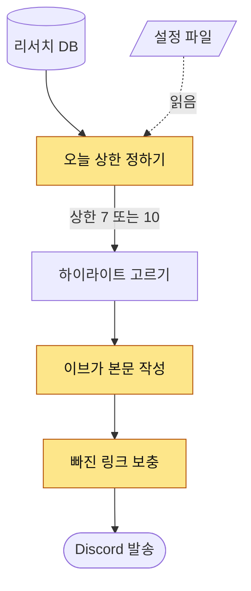

# Explain

Turn code or a change into one top-down explanation the user can understand in a single read,
without back-and-forth. Big picture first (purpose → architecture → file tree), then the details.

**Target**: $ARGUMENTS

## Step 1: Pick the target and mode

| Argument | Target | Mode |
|---|---|---|
| empty, working tree has changes | uncommitted changes (+ what this session did) | change |
| empty, clean tree | `HEAD` commit | change |
| commit / range / branch | `git show` / `git diff <base>...<branch>` | change |
| file, folder, repo | that code as it is now | code |

Never ask which target — pick by this table and fill it into §0 `대상:` (no extra line above §0).

## Step 2: Gather evidence (read before writing)

- **change**: `git show --stat` / `git diff --stat`, then the full diff, then read each changed
  file around the hunks. Note whether test files changed. `grep` callers/users of changed
  functions, config keys and outputs outside the diff (for 영향 범위).
- **code**: entry points (main, CLI, routes, scripts), imports, callers (`grep`), config, tests, README.
- **Request / reason** (both modes), in this order: this conversation, commit message, PR body,
  plan/notes files, docstrings or comments that quote the user. Cite where it came from.
- 15+ relevant files: split into 2–4 areas and send parallel Explore subagents; each returns
  purpose, connections, key `path:line` per piece. Synthesize; don't re-read everything.
- Verification claims come only from what was actually run (now or visibly in this conversation)
  — command + result. Cheap read-only checks (tests, `--help`, a dry run) may be run now.
  Everything else goes under "확인 안 된 것".

## Step 3: Write the output in exactly this shape

Plain Korean (해요체), short sentences that start with the action. Identifiers in backticks
followed by their plain meaning the first time (`s_limit()` = 오늘 상한을 정하는 함수).
Every claim about code carries `path:line` from the current working tree; if that file differs
from the explained commit, add "(현재 작업 트리 기준)" once.

````markdown
## 0. 한 줄 요약
대상: <commit/branch/path> · 종류: <변경 설명 | 코드 설명>
변경 성격 (change mode): <기능 추가 | 버그 수정 | 리팩터 | 설정·문서 | 테스트> (여럿이면 주된 것 먼저)
규모: <change: 파일 N개, +A/−D | code: 파일 N개, 총 L줄>
<one sentence: what this does and why it matters>

## 1. 목적과 큰 방향
- 요청/문제: <original ask, quoted if available; code mode: why this code exists>
- 목표: <what "done" means>
- 큰 방향: <the approach in 1–2 lines> — 고른 이유: <why> / 버린 대안: <alt or "기록 없음">
- 제약: <limits, assumptions>
- 전 → 후 (change mode): 전: <behavior before, as the user sees it> / 후: <behavior after>
- 핵심 용어 (≤5, only terms needed to read §2–§4; omit the table if none):

| 용어 | 뜻 |

## 2. 아키텍처

<rules: 5–12 concept nodes with plain Korean labels, always in "double quotes"; main path
 top-down; side inputs (DB, config, cache, external API) as their own nodes with dotted -.-> edges;
 edge labels = short plain words; ids = short ascii (db, limit); 2–4 `subgraph` only if it helps.
 change mode: `class … changed` on changed nodes · code mode: `class … target` +
 `classDef target fill:#bfdbfe,stroke:#1d4ed8,color:#111`. No function/file names as labels.>
흐름: 입력 <…> → 처리 <…> → 출력 <…>
영향 범위: <outside the change/target: who calls or reads it — `path:line` each, ≤6 bullets
 (group by layer if more); "찾은 곳 없음 (grep <pattern>)" if none>

## 3. 파일 트리
<tree of only the relevant dirs; right-hand comment = role in ≤8 words;
 change mode: mark [새] [수정] [삭제] · code mode: mark target ← 여기, callers/callees around it>

| 묶음 | 파일 | 역할 | 바뀐 점 (change mode only) |
<group rows by related change, like a PR walkthrough>

## 4. 세부 — 순서대로
### 4-1. <chunk name>  (처음엔 …)
- 무엇을: …
- 왜: …
- 근거: `path:line` `function()`
<optional: the single most illuminating snippet, ≤5 lines>
### 4-2. <chunk name>  (그다음 …)
...
<order = work order (change) or data-flow order (code); 3–6 chunks; ≤3 snippets in total>

## 5. 확인
| 확인한 것 | 방법 (명령/파일) | 결과 |
- 확인 안 된 것: <list; never empty-by-omission — write "없음" only if truly none>
- 틀렸던 예측 / AI가 고친 곳: <from conversation/commit history, or "기록 없음">

## 6. 위험하거나 헷갈리는 곳
- <where it breaks: scale, missing/odd input, config change, boundary values> — `path:line`
- <test files changed? say so explicitly>
- 리뷰 난이도: <1–5> — <one-line reason>

## 7. 셀프 체크
1. <why-this-choice question> → 답 위치: §<n>, `path:line`
2. <where-it-breaks question> → 답 위치: …
3. <how-was-it-verified question> → 답 위치: …
````

Section 7 has exactly 3 questions (why-this-choice, where-it-breaks, how-verified). They ask only about things explained above, and are specific to this code
(name the function, value, file). Do not wait for answers; the output ends after §7.

## Step 4: Long output

Decide before writing. If change mode has 8+ changed files, or code mode's target is 400+ lines
or 8+ files: write the full text to `~/.claude/explain/<repo>-<slug>-<YYYYMMDD>.md`, and print
§0–§3, the file path, and up to 3 lines of the most important §5/§6 points in the reply.
`<slug>` = target basename or short commit hash, kebab-case. Otherwise print everything in the reply.

## Follow-up

If the user answers a §7 question wrong or says a part is unclear, re-explain only that part:
① the specific spot (`path:line`) → ② why it matters / what breaks → ③ how to check it yourself.

## Common mistakes

| Mistake | Instead |
|---|---|
| Starting with details (functions, diffs) | §1–§3 first, always |
| Purpose invented from the code alone | Quote the request; if none found, write "요청 원문 없음 — 코드로 추정" |
| "테스트 통과" without a run | Command + result in §5, or move to 확인 안 된 것 |
| Diagram of functions/file names | Concepts with plain labels, 5–12 nodes |
| Mermaid label with ( ) : or Korean unquoted | Every label in "double quotes" — unquoted special chars break rendering |
| Listing every file in §4 | 3–6 chunks by meaning; file list belongs in §3 |
| Jargon without meaning | backtick name + plain meaning on first use |
| Generic §7 questions | Cite a concrete value/function from this code |
